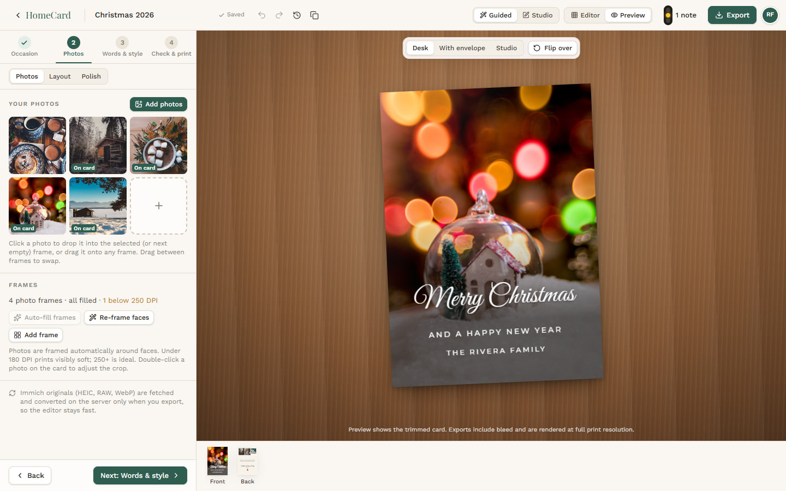
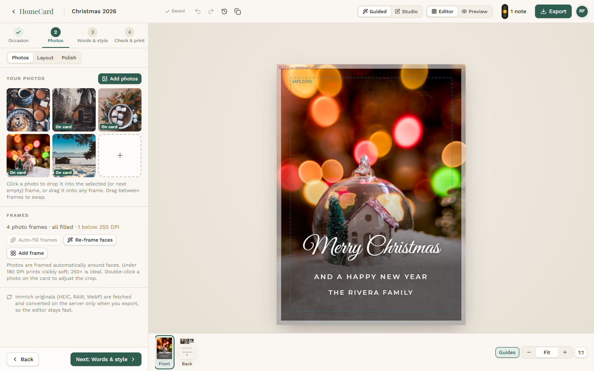
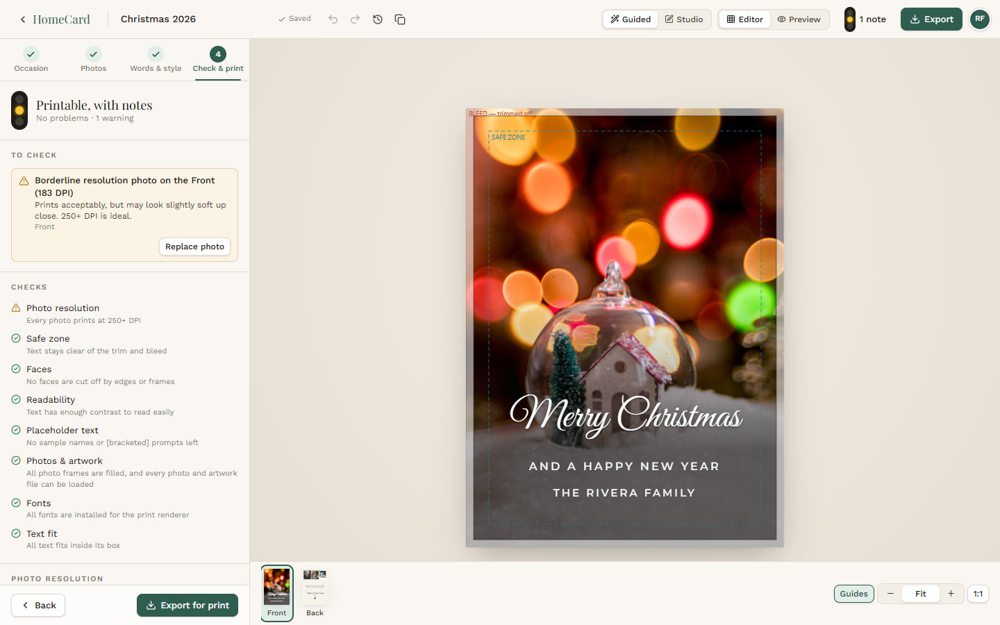
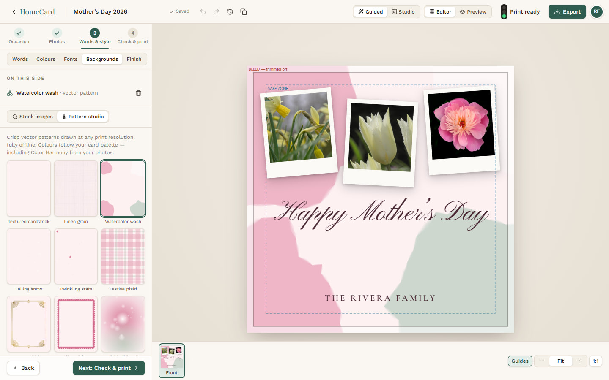
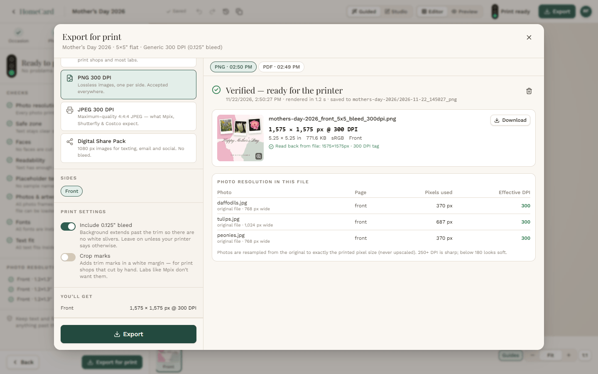
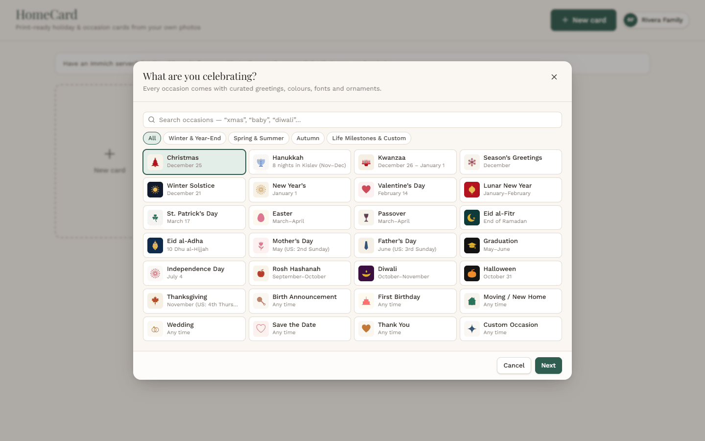
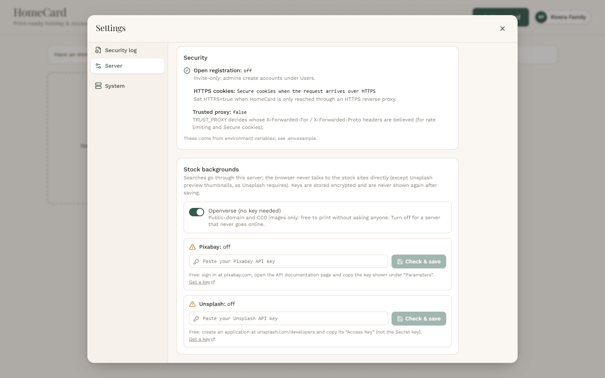

# HomeCard

**Self-hosted, print-ready holiday and occasion cards, made from your own photos.**



HomeCard is a card studio you run on your own server. Pick photos from **Immich**, a photo folder
or your phone, choose an occasion, and HomeCard sets up the layout, the face-aware crop, the
colours and the greeting. Change anything you like, then export files that a print lab accepts
as they are: real 300 DPI, bleed and safe zones, vector text in the PDF, sRGB or CMYK.

* **One Docker container.** No cloud account, no telemetry, no subscription.
* **Multiple users, private by default.** Everyone in the household gets their own sign-in.
  Cards, uploads, exports and Immich libraries are never visible to anyone else.
* **Read-only Immich.** HomeCard refuses Immich keys that could change your library, and its
  Immich client can only send read requests.
* **Clean files.** Exports carry no EXIF, GPS or camera data, so your home location never
  reaches a print shop.

Version 0.13.3 · [MIT licence](LICENSE) · works on any Docker host, with a ready-made script for
Unraid.

---

## Screenshots

| | |
|---|---|
|  **Guided editor.** Four steps from occasion to print. Photos are framed around faces automatically. |  **Print Guardian.** Checks resolution, safe zones, faces, contrast and fonts before you export, with one-click fixes. |
|  **Pattern & Paper Studio.** Vector backgrounds drawn on the spot, in your card's colours. No internet needed. |  **Verified exports.** Every file is read back: pixel size, DPI, colour space, each photo's effective DPI. |
|  **29 occasions.** Christmas to Diwali to birthdays and birth announcements, each with greetings, palettes and ornaments. |  **Set up in the app.** Add stock-image keys and the Immich address without touching the terminal. |

The photos in these screenshots are public domain ([credits](docs/images/CREDITS.md)) and the
family is made up.

---

## Contents

1. [Features](#features)
2. [Install with Docker Compose](#install-with-docker-compose)
3. [Install on Unraid](#install-on-unraid)
4. [First steps](#first-steps)
5. [Updating and backups](#updating-and-backups)
6. [Accounts and security](#accounts-and-security)
7. [Connecting Immich](#connecting-immich-read-only-per-person)
8. [Backgrounds and stock images](#backgrounds-and-stock-images)
9. [Fonts and style packs](#fonts-and-style-packs)
10. [Printing: which file to send where](#printing-which-file-to-send-where)
11. [Configuration reference](#configuration-reference)
12. [Troubleshooting](#troubleshooting)
13. [Development](#development)
14. [Legal notes](#legal-notes)
15. [Licence](#licence)
16. [Support](#support)

More detail: [docs/SECURITY.md](docs/SECURITY.md) (security model and how to check it yourself),
[docs/ARCHITECTURE.md](docs/ARCHITECTURE.md), [docs/STYLE_PACKS.md](docs/STYLE_PACKS.md),
[docs/VERIFICATION.md](docs/VERIFICATION.md).

---

## Features

**Two ways to work**

* **Guided mode**, in four steps: *Occasion → Photos → Words & style → Check & print*. Each step
  picks sensible defaults, so you can stop at any point.
* **Studio mode**, a free-form editor: templates, photos, text, colours, photo polish,
  decorations and layers, an inspector for the selected element, snap guides, keyboard nudging,
  undo/redo, autosave, version history and a 1:1 zoom.

**For the whole household**

* **One server, everyone's cards.** The admin adds people under **Users**, and each person sets
  their own password at first sign-in. Give a second person the admin role if you like.
* **Each person's work stays theirs.** Cards, version history, uploads, exports, photo folders
  and Immich libraries belong to one person. Fonts, style packs, stock backgrounds and
  `photos/shared/` are there for everyone.
* **Hand a card over.** **⋯ → Share copy with another user** gives someone their own copy to
  change, without access to your photos or your Immich library.
* **What's coming up.** The home page greets you with the next holiday ("Thanksgiving is in 3
  days"), print timing and one click to plan its card. **See pictures from this time** gathers
  your own Immich photos from the same weeks in past years, your recent favourites, matching
  albums and tags; pick up to six and HomeCard starts the card with them placed. Hide holidays
  you don't celebrate in **Settings → Holidays**.

**Photos**

* **Immich**: each person links **their own** read-only key, then browses Albums, People,
  Favorites, the Timeline and Smart Search. Find an album by typing its name, sort albums by
  title or date, and star favourite albums to keep them at the top. At export HomeCard fetches the **original** (HEIC,
  RAW and WebP are converted) and deletes the temporary copy as soon as the render is done.
* **Photo folders** (mounted read-only): `shared/` is visible to everyone, `users/<username>/`
  only to that person. New files appear automatically.
* **Upload** from your computer or phone. Uploads are private to you.
* **Face-aware smart crop**, using Immich's face boxes or in-browser face detection (the model is
  bundled; nothing is uploaded). Heads stay clear of the fold, the trim and the text.
* **Turn, mirror, flip and straighten** a placed photo inside its frame (free rotation with a
  handle or slider), nudge the crop with the arrow keys, reset the framing, or reshape the frame
  to the photo so nothing is cropped.
* **Auto-Enhance**, 6 film-style filters and 11 sliders. The same maths runs on the
  full-resolution original at export, so the print matches the screen.

**Design**

* **29 occasions** with greetings in 5 styles (short, warm, formal, humorous, family update),
  palettes and SVG ornaments.
* **29 templates**, and switching template keeps your photos, crops and words.
* **Sizes**: 5×7, 4×8, 5×5, A2, 6×8, 4×6, the ISO sizes A6, A5, A4, DL and 150 mm square, or
  custom (2″–14″, 51–355 mm), portrait or landscape, flat or folded (front, back and inside).
  Save your own card stock as a named size, star the sizes you use, and work in inches or
  millimetres.
* **Color Harmony** reads your photos and suggests contrast-checked colour themes.
* **Backgrounds**: Pixabay, Unsplash and Openverse search, or the offline Pattern & Paper Studio
  (cardstock, linen, watercolour, snowfall, stars, plaid, Art Deco borders, scalloped frames,
  glows).
* **21 open-licence font families** in designer pairings, plus your own fonts.
* **Style packs** (plain JSON, SVG and images) add palettes, papers, foils, ornaments, stickers,
  templates and font pairings. 17 are included: four starter packs plus thirteen collections
  (winter holidays, festivals of light and faith, spring, summer, autumn, Halloween, weddings,
  baby and birthdays, birthdays with 20th–50th milestone covers, milestones and everyday styles) with about 310 palettes, 200 papers,
  180 ornaments and 130 layouts. The editor opens the collections made for your occasion
  and folds the rest away.
* **Mockup preview**: the card on a desk or with its envelope, flipped, or opened if folded.

**Print Guardian**, a traffic light that checks before you export:

* effective photo DPI (yellow below 250, red below 180) and low-resolution backgrounds
* text and faces outside the safe zone
* text contrast, measured against the real background (photos, images and patterns)
* overflowing text, empty photo frames, placeholder text and missing fonts

**Export**

| Format | Details |
|---|---|
| **PDF** | 300 DPI images, **vector text with embedded fonts**, bleed with TrimBox and BleedBox, optional crop marks, sRGB or **CMYK** (Ghostscript, with your own ICC profile if you have one) |
| **PNG** | Exact 300 DPI pixels (1575 × 2175 px for a 5×7 with bleed), sRGB profile, DPI tag |
| **JPEG** | Quality 98–100 with **4:4:4 chroma** (no colour bleed on red and green text), the format Mpix, Shutterfly and Costco expect |
| **Share pack** | 1080 px images for texting and social media |

After each export HomeCard reads the files back and shows their size, DPI, colour space, each
photo's effective DPI, and confirms the files carry **no metadata**.

---

## Install with Docker Compose

You need Docker with Compose v2, about 2 GB of disk for the image, and 1–2 GB of free RAM while
exporting.

```sh
git clone https://github.com/AftermathLK/HomeCard.git homecard
cd homecard
cp .env.example .env
openssl rand -base64 48                 # copy the output into APP_ENCRYPTION_KEY= in .env
docker compose up -d --build
```

Then open **http://\<your-server\>:8787** and continue with [First steps](#first-steps).

The first build takes a few minutes because it downloads a headless Chromium for rendering.
After that, HomeCard starts in a few seconds.

> **Keep `APP_ENCRYPTION_KEY` safe and unchanged.** It encrypts everyone's Immich key and the
> stock-image keys. Store it in your password manager next to your backups.

To use your existing photo library, set `PHOTOS_PATH` in `.env` to that folder (it's mounted
read-only), and put photos in `shared/` (everyone) or `users/<username>/` (one person) inside it.

<details>
<summary><b>Without Compose (plain <code>docker run</code>)</b></summary>

```sh
docker build -t homecard .
docker run -d --name homecard -p 8787:8787 --shm-size=1g \
  --read-only --tmpfs /tmp:size=2g,mode=1777 \
  --cap-drop ALL --cap-add CHOWN --cap-add DAC_OVERRIDE --cap-add SETUID --cap-add SETGID \
  --security-opt no-new-privileges:true \
  -e PUID=1000 -e PGID=1000 \
  -e APP_ENCRYPTION_KEY="<output of: openssl rand -base64 48>" \
  -v /srv/homecard/config:/data/config \
  -v /srv/homecard/projects:/data/projects \
  -v /srv/homecard/uploads:/data/uploads \
  -v /srv/homecard/exports:/data/exports \
  -v /srv/homecard/fonts:/data/fonts \
  -v /srv/homecard/styles:/data/styles \
  -v /srv/homecard/cache:/data/cache \
  -v /path/to/your/photos:/data/photos:ro \
  --restart unless-stopped \
  homecard
```

Use the same key every time you recreate the container.

</details>

---

## Install on Unraid

No plugins needed. The included script builds the image and runs the container with the same
hardening as `docker-compose.yml`. Open a terminal on Unraid (the `>_` icon in the web UI):

```sh
# 1. Get the source onto the server
git clone https://github.com/AftermathLK/HomeCard.git /mnt/user/appdata/homecard-src

# 2. Build and start
cd /mnt/user/appdata/homecard-src && bash docker/unraid.sh update
```

No `git` on your server? Download the ZIP from the green **Code** button, extract it into
`/mnt/user/appdata/homecard-src`, and run step 2.

The first run creates `.env` with a new `APP_ENCRYPTION_KEY`. **Save that key** in your password
manager (`grep APP_ENCRYPTION_KEY .env` shows it). When the script prints *HomeCard is up*, open
the address it shows. The container appears in the Docker tab with a WebUI link and starts with
the array.

| | Default | Change it in `.env` |
|---|---|---|
| Data | `/mnt/user/appdata/homecard` | `HOMECARD_DATA` |
| Photos (read-only) | `/mnt/user/appdata/homecard/photos` | `PHOTOS_PATH`, e.g. `/mnt/user/photos` |
| Web UI | port `8787` | `HOMECARD_PORT` |
| Runs as | `99:100` (nobody:users) | `PUID`, `PGID` |

After editing `.env`, run `bash docker/unraid.sh restart`.

| Command (in `homecard-src`) | What it does |
|---|---|
| `bash docker/unraid.sh update` | Copies the source from `HOMECARD_SOURCE` (if set), rebuilds the image, replaces the container, waits until HomeCard answers, removes the old image |
| `bash docker/unraid.sh rebuild` | The same without the copy step |
| `bash docker/unraid.sh restart` | Recreates the container from the current image (after editing `.env`) |
| `bash docker/unraid.sh stop` / `logs` / `status` | Stop it, follow the log, or check that it answers |

If start-up fails, the script prints the last log lines instead of reporting success. The key
reaches the container through its environment, so it isn't written into an Unraid template on
the flash drive.

**Keeping the source in a synced folder** (Nextcloud, Syncthing, a share you edit from your PC):
add `HOMECARD_SOURCE=/mnt/user/<share>/<path>/HomeCard` to `.env` once. `update` then copies the
latest source in before building. The copy replaces everything in `homecard-src` except `.env`
and `homecard-data/`.

<details>
<summary><b>Prefer the Compose Manager plugin or the Docker tab?</b></summary>

Build the image first: `cd /mnt/user/appdata/homecard-src && docker build -t homecard:latest .`

**Compose Manager plugin:** add a stack pointing at `/mnt/user/appdata/homecard-src`, create
`.env` next to the compose file with `APP_ENCRYPTION_KEY`, `HOMECARD_DATA=/mnt/user/appdata/homecard`,
`PHOTOS_PATH=/mnt/user/photos`, `PUID=99` and `PGID=100`, then **Compose Up**.

**Docker tab → Add Container:**

| Field | Value |
|---|---|
| Repository | `homecard:latest` |
| Network | `bridge`, container port `8787` → host `8787` |
| Extra parameters | `--shm-size=1g --read-only --tmpfs /tmp:size=2g,mode=1777 --cap-drop ALL --cap-add CHOWN --cap-add DAC_OVERRIDE --cap-add SETUID --cap-add SETGID --security-opt no-new-privileges:true` |
| Variables | `APP_ENCRYPTION_KEY` (required), `PUID=99`, `PGID=100`, optional `TRUST_PROXY` |
| Paths | `/mnt/user/appdata/homecard/{config,projects,uploads,exports,fonts,styles,cache}` → `/data/{same}`; your photo share → `/data/photos` (**read-only**) |

</details>

---

## First steps

1. **Create the admin account.** The first visit shows *Set up HomeCard*.
2. **Add the household** under **your name (top right) → Users**. Each person gets a temporary
   password they replace at first sign-in. Accounts are invite-only.
3. **Optional: connect Immich.** Admin: **Server settings → Immich server address**. Then each
   person links their own read-only key (see [Connecting Immich](#connecting-immich-read-only-per-person)).
4. **Optional: stock images.** Openverse (public domain) works without a key. For Pixabay and
   Unsplash, paste a free API key in **Server settings → Stock backgrounds**.
5. **Make a card:** **New card** → pick the occasion → add photos → **Check & print** → **Export**.

---

## Updating and backups

**Update:** pull the new code (`git pull`, or a fresh ZIP) and run `docker compose up -d --build`,
or `bash docker/unraid.sh update` on Unraid. Accounts, cards, exports, fonts and packs live in
the data folders and aren't touched.

**Back up** these folders, together with `APP_ENCRYPTION_KEY`:

| Folder | What's in it | Back up? |
|---|---|---|
| `config` | `homecard.db`: accounts, encrypted keys, settings, security log; `icc/` for your CMYK profiles | **Yes** |
| `projects` | Cards, version history and thumbnails, per user | **Yes** |
| `uploads` | Photos uploaded in the browser, per user | **Yes** |
| `exports` | Finished print files, per user | Yes |
| `fonts`, `styles` | Your fonts, style packs and downloaded stock backgrounds (shared) | Yes |
| `cache` | Thumbnails and converted originals | No, it rebuilds |
| `photos` | Your photo library, mounted read-only | Your own backup |

Deleted cards and the data of deleted accounts go to a `.trash` folder in each volume and are
removed after 30 days.

---

## Accounts and security

* **Nothing works without signing in.** Every page, API call, photo, thumbnail, export and
  Immich request needs an account. Only `/login`, the one-time `/setup` and `/health` are open.
* **Invite-only.** The admin creates, resets, unlocks, disables and deletes accounts. Set
  `ALLOW_REGISTRATION=true` only if anyone on your network may create an account.
* **Private by default.** Fonts, style packs and `photos/shared/` are shared; everything else
  belongs to one person. **⋯ → Share copy with another user** gives someone their own copy of a
  card, without access to your Immich library or folders.
* **Hardened sign-in.** Argon2id password hashes, `HttpOnly` / `SameSite` session cookies,
  lockout after 5 wrong passwords (doubling up to 24 hours), CSRF protection, and strict security
  headers (CSP, `X-Frame-Options: DENY`, `nosniff`).
* **Encrypted secrets.** Immich and stock-image keys are encrypted with AES-256-GCM and only
  their last 4 characters are ever shown again.
* **Hardened container.** Read-only file system, all capabilities dropped after start-up, never
  runs as root, `no-new-privileges`.
* **Security log.** Admins see sign-ins, failed attempts, lockouts, key changes, user changes
  and exports.
* **Behind an HTTPS reverse proxy**, set `TRUST_PROXY` (and `HTTPS=true` if HomeCard is only
  reached over HTTPS) so cookies are `Secure` and the log shows real client IPs.

HomeCard is meant for your home network or behind a reverse proxy you control. The full model,
with checks you can run yourself, is in **[docs/SECURITY.md](docs/SECURITY.md)**.

---

## Connecting Immich (read-only, per person)

**Admin, once:** set the Immich address in **Server settings** (or `IMMICH_URL` in `.env`). Use
the address the HomeCard **container** reaches Immich at: the LAN IP, or the Immich container's
name on a shared Docker network (`localhost` would mean the HomeCard container itself).

**Each person:** open **your name → Immich connection** and follow the checklist:

1. In Immich, open **Account Settings → API Keys → New API Key**. Leave **all** unticked.
2. Tick only `album.read`, `asset.read`, `asset.view`, `asset.download`, `person.read`,
   `apiKey.read` (lets HomeCard confirm the key is read-only) and optionally `memory.read` and
   `tag.read` (matches photos you tagged "Christmas" or "Holidays/Easter" to upcoming holidays).
3. Paste the key into HomeCard → **Check key** → **Save read-only key**.

HomeCard asks Immich what the key may do and **refuses** any key with `all`, create, update,
delete, upload or admin permissions (for tags that includes `tag.create`, `tag.update`,
`tag.delete` and `tag.asset`: HomeCard only ever reads tags). On top of that, its Immich client blocks every request
except the read endpoints it needs. Nobody else can browse your library through HomeCard, not
even the admin.

---

## Backgrounds and stock images

In the editor: **Words & style → Backgrounds** (Guided) or **Backdrop** (Studio).

* **Stock images:** search or click a preset (*Gold bokeh*, *Snowflakes seamless*, *Christmas
  watercolor pine*…). Each result shows the DPI it would print at on your card. Lower-resolution
  images get **Soften** automatically, so they print smooth instead of pixelated.
  * **Openverse**: public-domain and CC0 images, no key needed.
  * **Pixabay** and **Unsplash**: an admin pastes a free API key in **Server settings**. HomeCard
    checks the key with the provider first, then stores it encrypted.
    Get one at [pixabay.com/api/docs](https://pixabay.com/api/docs/) or
    [unsplash.com/oauth/applications](https://unsplash.com/oauth/applications) (use the
    *Access Key*).
  * Searches go through your server, never straight from the browser (except Unsplash preview
    thumbnails, which Unsplash requires to load from its own servers). The image you pick is
    downloaded once to your server, with its credit.
* **Pattern & Paper Studio:** nine vector backdrops generated on the spot, at any print
  resolution, without internet. Shuffle for a new variation, adjust amount, size and strength;
  colours follow your card palette.

---

## Fonts and style packs

* **Fonts** (shared): drop `.ttf`, `.otf`, `.woff` or `.woff2` files into the `fonts` folder, or
  use **Settings → Fonts → Upload**. They appear in every font menu within seconds, and PDFs
  embed them as real vector text.
* **Style packs**: a folder in `styles` with a `pack.json`, or a `.zip` / `.json` an admin imports in
  **Settings → Style packs**. See **[docs/STYLE_PACKS.md](docs/STYLE_PACKS.md)** for the format.
* **Quick uploads**: **Settings → Style packs → Upload assets** for papers, SVG ornaments or
  stickers, no JSON needed.

Only add fonts and artwork you're allowed to print.

---

## Printing: which file to send where

Pick the printer when you create the card (or later in **Card setup**). The preset sets bleed,
safe zone and file type. The values follow each printer's published specs at the time of
writing; printers change them, so compare with the printer's own template before a big order.

| Preset | Bleed | Send | Notes |
|---|---|---|---|
| Generic 300 DPI | 0.125″ | PDF | Works for most labs and local print shops |
| Mpix | 0.125″ | JPEG (100, 4:4:4) | sRGB, 300 DPI |
| Shutterfly | 0.125″ | JPEG | Upload-your-own-design; mind the 25 MB limit |
| Walgreens / CVS / Costco | none | JPEG | Photo print at the exact size; choose "no crop / fit" |
| Vistaprint | 0.105″ | PDF | Upload-your-design |
| Staples / FedEx Office | 0.125″ | PDF, CMYK, crop marks | In-store production |
| Zazzle / Canva Print | 0.125″ | PNG (or PDF) | Full-bleed upload |
| Borderless home print | none | PNG | Exact card size with a 0.2″ safe margin |

Folded cards export as **spreads** (outside and inside sheets, what most labs want) or as
**panels** (one file per page).

---

## Configuration reference

Only `APP_ENCRYPTION_KEY` is required. [.env.example](.env.example) explains every variable.

<details>
<summary><b>Host side</b> (used by <code>docker-compose.yml</code> and <code>docker/unraid.sh</code>)</summary>

| Variable | Default | Meaning |
|---|---|---|
| `HOMECARD_PORT` | `8787` | Host port for the web UI |
| `HOMECARD_DATA` | `./homecard-data` (Compose), `/mnt/user/appdata/homecard` (Unraid script) | Host folder for the data |
| `PHOTOS_PATH` | `$HOMECARD_DATA/photos` | Photo folder, mounted read-only at `/data/photos` |
| `HOMECARD_SOURCE` | — | Unraid script only: folder to copy the source from before building |

</details>

<details>
<summary><b>Security</b></summary>

| Variable | Default | Meaning |
|---|---|---|
| `APP_ENCRYPTION_KEY` | **required** | 32+ random characters (`openssl rand -base64 48`). Encrypts Immich and stock keys. If it changes, those keys must be entered again. |
| `SESSION_SECRET` | *(derived)* | Optional separate key for session tokens. Changing it signs everyone out. |
| `ALLOW_REGISTRATION` | `false` | `true` lets anyone who can reach HomeCard create an account |
| `TRUST_PROXY` | *(off)* | Reverse proxy to trust: `true`, a hop count (`1`) or IPs/CIDRs (`172.18.0.0/16`) |
| `HTTPS` | `false` | `true` = always `Secure` cookies and HSTS |
| `SESSION_IDLE_DAYS` / `SESSION_MAX_DAYS` | `14` / `60` | Sign-ins expire after this many idle days / days in total |

</details>

<details>
<summary><b>Immich and stock images</b> (all optional; easier to set in the app)</summary>

| Variable | Default | Meaning |
|---|---|---|
| `IMMICH_URL` | *(empty)* | Immich address as reachable from the container, e.g. `http://192.168.1.20:2283` |
| `PIXABAY_API_KEY` | *(empty)* | Pixabay key |
| `UNSPLASH_API_KEY` | *(empty)* | Unsplash *Access Key* |
| `OPENVERSE_ENABLED` | *(empty = on)* | `false` for a server that never goes online |

A variable that is set wins over the in-app setting and locks it.

</details>

<details>
<summary><b>Container</b></summary>

| Variable | Default | Meaning |
|---|---|---|
| `PUID` / `PGID` | `99` / `100` | User and group the server runs as (never root) |
| `UMASK` | `027` | New files readable by owner and group only |
| `TZ` | `Etc/UTC` | Time zone for export folder names and logs |
| `RENDER_CONCURRENCY` | `2` | Parallel renders; each uses about 300–600 MB of RAM |
| `CACHE_MAX_MB` | `4096` | Size cap for the cache folder |
| `MAX_UPLOAD_MB` | `200` | Largest photo upload |
| `WATCH` / `WATCH_POLLING` | `true` / `false` | Live-reload fonts, packs and photos; use polling on SMB/NFS mounts |
| `LOG_LEVEL` | `info` | `fatal` … `trace` |
| `PORT` / `HOST` | `8787` / `0.0.0.0` | Listen address inside the container |

</details>

<details>
<summary><b>Advanced</b></summary>

| Variable | Default | Meaning |
|---|---|---|
| `DATA_DIR` | `/data` | Root of all data folders (`./.devdata` outside Docker) |
| `PROJECTS_DIR`, `UPLOADS_DIR`, `PHOTOS_DIR`, `FONTS_DIR`, `STYLES_DIR`, `EXPORTS_DIR`, `CONFIG_DIR`, `CACHE_DIR` | `$DATA_DIR/<name>` | Move a single data folder |
| `EPHEMERAL_DIR` | `/tmp/homecard-ephemeral` | Scratch folder for originals during an export (wiped after each render) |
| `CHROMIUM_PATH` | *(Playwright's Chromium)* | Use another Chromium or Chrome |
| `GHOSTSCRIPT_PATH` | *(`gs` on PATH)* | Ghostscript for CMYK PDFs and proofs |
| `RENDER_ORIGIN` | *(this server)* | Where headless Chromium loads the renderer from |

</details>

---

## Troubleshooting

| Symptom | Fix |
|---|---|
| Container exits: "APP_ENCRYPTION_KEY is not set" / "too short" | Set it in `.env` to 32+ random characters: `openssl rand -base64 48` |
| Forgot the admin password | Another admin can reset it under Users. Otherwise: `docker exec -it -u 99:100 homecard node apps/server/dist/cli.js reset-password <username>` (use your `PUID:PGID`). `list-users`, `enable <username>` and `unlock-all` also exist. |
| "Too many failed sign-in attempts" | Wait for the time shown, or ask an admin to unlock you |
| Behind a proxy, everyone gets locked out together | Set `TRUST_PROXY` to your proxy (e.g. `1` or its Docker network CIDR) |
| **Settings → System** says the renderer is unavailable | The container needs `--shm-size=1g` (already in the compose file and script) |
| Immich: "connection refused" or a timeout | The address must work **from inside the container**: use the LAN IP or a shared Docker network |
| Immich key refused: "This key can change your photo library" | Working as intended: create a key with only the read permissions listed above |
| "Your saved key can't be read any more" | `APP_ENCRYPTION_KEY` changed. Enter the key again. |
| My photo folder is empty in the picker | Photos must be in `photos/shared/` or `photos/users/<your username>/` |
| Stock search is greyed out | An admin can turn on Openverse or add a Pixabay / Unsplash key in **Server settings** |
| New fonts, packs or photos don't show up | **Settings → Fonts / Style packs → Rescan**; on SMB/NFS mounts set `WATCH_POLLING=true` |
| Permission denied writing `/data/...` | Set `PUID`/`PGID` to the owner of your host folders |
| Export is slow or runs out of memory | Set `RENDER_CONCURRENCY=1` or give the container more RAM |

`/health` returns `{"status":"ok"}` for health checks. Signed in, **Settings → System** shows the
renderer, Ghostscript and Immich status.

---

## Development

Requirements: Node.js 24.7 or newer (HomeCard uses the built-in `node:sqlite` and
`crypto.argon2`), npm 10, and Chrome/Chromium or `npx playwright install chromium`. Ghostscript
is optional (CMYK and PDF proofs).

```sh
npm install
npm run dev          # API on :8787 + Vite on :5173 (open http://localhost:5173)
```

| Command | What it does |
|---|---|
| `npm run build` | Collects fonts and the face model, builds the web app (Vite) and the server (esbuild) |
| `npm start` | Runs the built server on :8787 |
| `npm run typecheck` | Type-checks shared, server and web |
| `npm test` | Unit tests: layout, crop, colour, Print Guardian, templates, backdrops, the read-only Immich allowlist, auth, per-user isolation, SVG sanitising, metadata scrubbing |

In development, data goes to `./.devdata` and a development encryption key is generated there.
The code layout is described in [docs/ARCHITECTURE.md](docs/ARCHITECTURE.md). Bug reports and
pull requests are welcome.

---

## Legal notes

**Not affiliated.** HomeCard is an independent open-source project. It isn't affiliated with,
endorsed or sponsored by Immich, Pixabay, Unsplash, Openverse, Lime Technology (Unraid) or any
printer named here (Mpix, Shutterfly, Walgreens, CVS, Costco, Vistaprint, Staples, FedEx Office,
Zazzle, Canva). Their names are used only to describe compatibility, and the trademarks belong
to their owners.

**Your photos stay with you.** HomeCard runs on your hardware, sends no telemetry and has no
cloud service. It only reaches the internet for the stock searches you turn on, from your
server, with your keys.

**Stock-image services.** Each HomeCard install uses its own keys, and whoever adds a key agrees
to that provider's API terms. HomeCard is built to follow them:

* *Pixabay*: search results are cached for at most 24 hours, chosen images are downloaded to your
  server rather than hotlinked, and results link back to Pixabay.
* *Unsplash*: preview thumbnails load from Unsplash, the download is reported to Unsplash when you
  use a photo, and the photographer and Unsplash are credited with links. A new Unsplash app
  starts in demo mode (50 requests an hour), which is plenty for a household; you don't need to
  apply for production access.
* *Openverse*: only CC0 and public-domain results are shown.

**Using stock images on your cards.** The Pixabay and Unsplash licences allow free use,
including on printed cards, without attribution. They don't allow selling the images unaltered
or as stand-alone prints or products, or using people in them in misleading or offensive ways.
Cards for family and friends are fine; if you sell cards, check each image's licence yourself.
HomeCard keeps each image's credit and licence next to the file.

**Fonts and artwork.** The bundled fonts are under the SIL Open Font License (a few Apache-2.0):
you can print with them freely, but not sell the fonts themselves. All bundled style packs are
CC0 (the twelve collections were made with AI assistance; see
[THIRD_PARTY_NOTICES.md](THIRD_PARTY_NOTICES.md)).
Only add fonts and artwork you're allowed to print.

**Printer specs** in the presets are a convenience, not a promise. Check your printer's current
requirements; HomeCard can't take responsibility for print results or orders.

**Third-party software.** See [THIRD_PARTY_NOTICES.md](THIRD_PARTY_NOTICES.md). The Docker image
includes Ghostscript (AGPL-3.0), run as a separate, unmodified program. Building the image for
yourself needs nothing extra; if you publish a built image, make Ghostscript's source available
as the AGPL asks (Debian's source package is enough).

---

## Licence

HomeCard is released under the [MIT licence](LICENSE). It comes with no warranty.

---

## Support

If HomeCard made your cards a little easier this year, you can buy me a coffee on
**[Ko-fi](https://ko-fi.com/aftermathlk)**. Thank you! ☕
